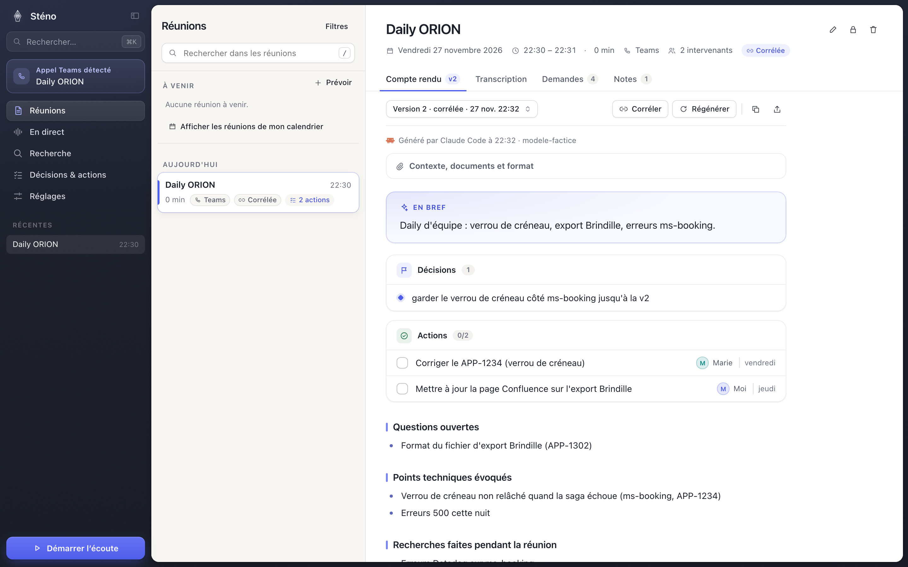

<p align="center"></p>

# Sténo

*[English](README.md) · Français*

**Assistant de réunion 100 % local pour Mac et Linux (Debian, Ubuntu).** Sténo transcrit vos appels (Teams, Slack,
Zoom, Webex, Discord, FaceTime, Google Meet…) et vos réunions en présentiel, rédige le compte
rendu et répond à vos questions à la voix en cherchant dans votre code, Jira, Confluence ou
Datadog. Il utilise l'agent IA que vous avez déjà (Claude Code, Codex, Gemini CLI, OpenCode…),
avec votre abonnement. Aucun audio ne sort de votre ordinateur, et **Sténo ne publie jamais rien** : il
lit, vous publiez.



## Fonctionnalités

- **Écoute manuelle** : rien n'est enregistré sans votre action. Quand un appel commence dans
  une app de visio, Sténo le propose ; vous démarrez depuis la barre de menu, ⌃⌥S (Ctrl+Alt+S
  sous Linux) ou la fenêtre. Arrêt en un clic, au raccourci ou à la voix (« *OK Sténo, arrête l'écoute* »).
- **Transcription en direct** sur votre ordinateur, avec votre voix (« Moi », micro) séparée de celle des
  autres (son de l'app de l'appel). Pause, micro coupé dans Sténo, suppression d'une phrase,
  filtre des phrases inventées sur du bruit.
- **Réunions en présentiel** : tout passe par le micro de l'ordinateur, les intervenants sont distingués
  en fin de réunion.
- **Retranscription de fin de réunion** avec un modèle plus précis et la langue imposée
  (français par défaut) : fini le mélange français/anglais du direct.
- **Intervenants** : identification en fin de réunion (« Intervenant 1, 2… »), renommables.
- **Commandes vocales** : « *OK Sténo, cherche les erreurs Datadog sur ms-booking depuis
  hier* », reconnues même en pleine phrase, ou en aparté (⌃⌥Espace maintenu ; sous Linux,
  Ctrl+Alt+Espace en bascule). Réponse courte en notification, réponse complète et sourcée
  dans l'app. Avec Claude Code, l'agent peut s'appuyer sur **vos skills** (Jira, Datadog,
  code…), toujours en lecture seule.
- **Compte rendu** : décisions, actions qui / quoi / échéance, questions ouvertes, points
  techniques, vos notes. Les apartés n'y figurent jamais.
- **Contexte et documents** : texte libre et documents joints (PDF, Excel, CSV, Word,
  Markdown…) pour orienter le compte rendu ; une section « ⚠️ Changements importants » signale
  ce qui contredit le contexte. Un délai après la réunion laisse le temps de les ajouter.
- **Préparation des réunions** : réunions à venir (prévues dans Sténo ou lues dans le
  calendrier : Calendrier de macOS ; sous Linux, GNOME Agenda / Evolution, comptes en ligne
  Google ou Microsoft 365, ou fichiers et adresses `.ics`), participants invités pour nommer les intervenants, et préparation
  guidée par l'IA (quelques questions, puis un contexte rédigé). Démarrer l'écoute à l'heure
  prévue reprend la réunion préparée.
- **Formats de sortie** : standard, daily, point client, atelier, arbitrage, mail de synthèse,
  message Slack/Teams, et vos propres formats enregistrés sur l'ordinateur, écrits à la main
  ou déduits d'un compte rendu que vous aimez. Une réunion récurrente reprend le format choisi
  la dernière fois.
- **Corrélation** (désactivée, à la demande ou automatique) : le compte rendu est croisé avec
  vos dépôts et connecteurs.
- **Exports** : copie mise en forme pour Teams/Slack/mail, Markdown, PDF, transcription
  `.txt`, sous-titres `.srt` / `.vtt`.
- **Historique** : recherche plein texte, décisions et actions, questions en langage naturel,
  et serveur MCP `steno mcp` (lecture seule) pour vos agents.
- **Sténo dans votre agent** : un skill et le serveur MCP installés en un clic dans Claude
  Code, Codex… (« *refais le compte rendu d'hier au format client* », « *quelles sont mes
  actions ouvertes ?* »).
- Interface et comptes rendus en **français ou en anglais** (automatique selon le système) ;
  thème clair, sombre ou automatique.

## Prérequis

**macOS**
- macOS 14.2 ou plus récent (Apple Silicon recommandé).
- Xcode (ou les Command Line Tools avec Swift 5.10+).

**Linux** (Ubuntu 22.04+, Debian 12+, x86_64 ou arm64)
- Bureau avec PipeWire (et `pipewire-pulse`, présent par défaut sur Ubuntu et Debian récents)
  ou PulseAudio.
- Les paquets de compilation : `make deps` les installe (`sudo apt install …`, liste dans le
  Makefile : `build-essential`, `meson`, `clang`, `libwebkit2gtk-4.1-dev`, `libpulse-dev`…).
- Un processeur récent à 4 cœurs suffit : la transcription tourne sur le CPU (environ dix fois
  plus vite que le temps réel).

**Partout**
- Rust stable (`rustup`) et Node 22 (pour compiler l'interface).
- Au moins un CLI d'agent installé et connecté : `claude`, `codex`, `gemini`, `opencode`…
- Environ 2 Go d'espace disque pour les modèles audio.

## Installation

### macOS

```bash
git clone https://github.com/NakileSolutions/Steno.git steno && cd steno
make install     # compile le sidecar audio, l'interface et l'app, signature locale,
                 # installe /Applications/Steno.app et la CLI ~/.local/bin/steno,
                 # télécharge les modèles audio
open /Applications/Steno.app
```

L'app est compilée sur votre Mac, sans compte développeur Apple : macOS ne la bloque pas
puisqu'elle n'a pas été téléchargée. Elle est signée avec un certificat local créé une fois
dans votre trousseau (« Steno Local Signing »), pour que les autorisations macOS (micro, audio
système…) soient conservées d'une mise à jour à l'autre. Pour l'installer ailleurs :
`make install APP_DIR=~/Applications`.

Au premier lancement, l'assistant vous guide : permissions macOS (micro, audio du système,
accessibilité facultative) ou, sous Linux, vérification du son et des raccourcis, choix et test de l'agent, dépôts lisibles, connecteurs, mot
d'appel et test vocal. Équivalent en ligne de commande : `steno init`. Diagnostic à tout
moment : `steno doctor`.

### Linux (Debian, Ubuntu)

```bash
git clone https://github.com/NakileSolutions/Steno.git steno && cd steno
make deps        # paquets de compilation (une fois, demande sudo)
make install     # compile le sidecar audio, l'interface et l'app, installe dans ~/.local
                 # (app, raccourci de bureau « Sténo », CLI ~/.local/bin/steno),
                 # télécharge les modèles audio (≈ 700 Mo)
```

Lancez « Sténo » depuis les applications. Rien n'est installé hors de votre dossier personnel
(`~/.local/lib/steno`, `~/.local/share/applications`, `~/.local/bin`) ; les données vont dans
`~/.local/share/Steno` et les modèles dans `~/.local/share/Steno/models`. Il n'y a pas
d'autorisation système à accorder : le micro et le son des apps de visio passent par le serveur
son de votre session.

Paquet Debian à la place : `make deb` produit `target/release/bundle/deb/steno_<version>_*.deb`
(`sudo apt install ./target/release/bundle/deb/*.deb`) ; les modèles sont alors téléchargés au
premier lancement.

Particularités de Linux :
- **Apps de visio** : client Teams non officiel (Teams for Linux), Slack, Zoom, Webex, Discord
  (paquets .deb, Snap ou Flatpak) ; Teams et Meet dans un navigateur via l'entrée
  « Navigateur ». Sténo capte le son de l'app de l'appel seule, pas celui des autres apps.
- **Raccourcis globaux** : ils fonctionnent sous X11. Sous Wayland (session par défaut
  d'Ubuntu), créez-les dans Paramètres › Clavier › Raccourcis personnalisés avec les commandes
  que Sténo affiche (`steno-app --toggle`, `--aside`, `--note`). Le menu de l'icône et le
  raccourci de bureau proposent aussi ces actions.
- **Barre d'état** : sous GNOME, l'icône de Sténo demande l'extension « AppIndicator »
  (installée par défaut sur Ubuntu).
- **Titre de l'appel** : lu sur les fenêtres X11 (les apps Electron passent souvent par
  XWayland) ; sinon la réunion prend le titre du calendrier ou un titre daté.
- **Calendrier** : celui de GNOME Agenda / Evolution (comptes en ligne compris) est lu
  automatiquement. Autres calendriers : une adresse ou un fichier `.ics` par ligne dans
  `~/.local/share/Steno/calendars.txt` (par exemple l'« adresse secrète au format iCal » d'un
  agenda Google, ou un calendrier Outlook publié).
- **Haut-parleurs** : l'annulation d'écho (WebRTC) retire la voix des participants de votre
  micro quand le son sort par des haut-parleurs ; elle se désactive d'elle-même avec un casque.

### Après l'installation

**Mises à jour** : Sténo vérifie sur GitHub si une nouvelle version est publiée et la signale
dans la barre latérale. « Installer » (Réglages → Mises à jour) met vos sources à jour sur la
version publiée puis relance `make install` ; il ne reste qu'à redémarrer. L'installation peut
être automatique (hors réunion). À la main : `git pull && make install`, ou `steno update --install`.

## Utilisation

| Où | Quoi |
|---|---|
| Barre de menu (barre d'état sous Linux) | Démarrer / arrêter l'écoute, réunion en présentiel, pause, micro coupé, dernières réponses, ouvrir Sténo |
| Fenêtre | Réunions (compte rendu, transcription, demandes, notes, contexte), En direct, Recherche, Décisions & actions, Réglages |
| Voix | « *OK Sténo, cherche / vérifie / note / résume / annule…* », « *OK Sténo, arrête l'écoute* » (mot d'appel et verbes réglables) |
| Raccourcis | ⌃⌥S démarrer/arrêter · ⌃⌥Espace aparté (maintenir) · ⌃⌥N note rapide (Linux : Ctrl+Alt+…, ou `steno-app --toggle / --aside / --note` liés dans les réglages du bureau) |
| CLI | `steno ask "qu'a-t-on décidé sur l'export ?"` · `steno export <id> [--format txt|srt|vtt]` · `steno doctor` · `steno mcp` · `steno skill install` |

Donner à votre agent l'accès aux réunions, en lecture seule : `steno skill install` (ou
Réglages → Agent → « Sténo dans votre agent »). Le skill est copié dans `~/.claude/skills` et
`~/.agents/skills`, et le serveur MCP `steno` est déclaré dans Claude Code et Codex.

## Confidentialité

- **L'audio ne quitte jamais votre ordinateur.** La transcription tourne en local. Les fichiers audio
  temporaires sont supprimés après le compte rendu (rétention réglable, 0 jour par défaut).
- **Tout est stocké localement** : base `~/Library/Application Support/Steno/steno.db` sur
  macOS, `~/.local/share/Steno/steno.db` sous Linux (droits 600), sauvegardes quotidiennes locales. Pas de serveur Sténo, pas de télémétrie,
  pas de compte.
- **Seul du texte est envoyé, et seulement à l'agent IA que vous avez choisi** : à votre
  demande, en fin de réunion pour le compte rendu, et pour la corrélation si vous l'activez.
  Il est traité selon les conditions de l'éditeur de cet agent.
- **Réunion confidentielle** : aucun appel à l'IA. Les réunions dont le titre contient
  « 1:1 », « RH », « entretien » ou « perso » ne sont jamais corrélées (réglable).
- **Les apartés** (raccourci maintenu) sont exclus du compte rendu et de la recherche.
- **L'agent ne fait que lire** et ne reçoit pas les clés d'API de l'environnement, sauf
  activation explicite.
- **Prévenez les participants** que la réunion est transcrite : Sténo propose un message prêt
  à coller dans le chat de l'appel (dans la langue de l'interface tant que vous ne le modifiez pas). Selon votre pays et votre contexte, leur consentement peut
  être obligatoire (RGPD en Europe).

Détails et signalement des failles : [`SECURITY.md`](SECURITY.md).

## Architecture

```
audio/StenoAudio/   sidecar Swift : capture Core Audio (process tap de l'app de l'appel,
                     micro HAL), VAD Silero, ASR Parakeet v3 et Canary (FluidAudio),
                     diarisation → JSON lines
crates/steno-audio-linux/
                     sidecar Rust pour Linux, même protocole : capture PulseAudio / PipeWire
                     (flux de l'app de l'appel, micro), annulation d'écho WebRTC, VAD Silero,
                     ASR Parakeet v3 et Canary (sherpa-onnx), diarisation, calendrier EDS
crates/steno-core/  Rust : SQLite (WAL + FTS5), file de tâches, mot d'appel, anti-écho,
                     adaptateurs d'agent, politique lecture seule, compte rendu, contexte
crates/steno-cli/   CLI `steno` : ask, doctor, init, export, mcp, serve, replay, simulate
app/src-tauri/       app Tauri 2 (barre de menu, notifications, raccourcis globaux)
app/ui/              interface Svelte 5 + Vite
agent/               consignes et procédures de l'agent, politique lecture seule
fixtures/            réunion synthétique de 45 min et faux CLI d'agent pour les tests
docs/                contrats entre composants, adaptateurs d'agent, spikes
```

## Développement

```bash
make test        # Rust (unitaires, acceptation, perf), Swift (macOS), Vitest, Playwright
make serve       # interface + vrai cœur dans le navigateur : http://127.0.0.1:4180/?backend=http
make simulate    # rejoue la réunion d'exemple dans tout le pipeline (faux agent)
make dev         # app avec rechargement à chaud, sidecar simulé, faux agent
cd app/ui && npm run dev   # l'interface seule, avec des données d'exemple
```

Les interfaces entre composants sont décrites dans [`docs/contracts.md`](docs/contracts.md),
les CLI d'agent dans [`docs/adapters.md`](docs/adapters.md), le plan initial dans
[`PLAN.md`](PLAN.md).

Les contributions sont bienvenues : ouvrez une issue pour en discuter avant une grosse
modification, et lancez `make test` avant de proposer une pull request. La branche `main`
n'accepte que des pull requests dont la CI est verte et dont les commits sont **signés**
(GPG ou SSH). Le code, les commits, les pull requests et la documentation technique sont en
**anglais**. Règles du projet, y compris pour les agents de développement (Claude Code,
Codex…) : [`AGENTS.md`](AGENTS.md). Publication d'une version : [`RELEASING.md`](RELEASING.md).

## Contributeurs

<a href="https://github.com/NakileSolutions/Steno/graphs/contributors">
  
</a>

## Licence

[MIT](LICENSE) © 2026 Nakile Solutions. Les modèles audio et les bibliothèques tierces ont
leur propre licence : voir [`NOTICE.md`](NOTICE.md).

---

<sub>Développé par Nakile Solutions.</sub>
