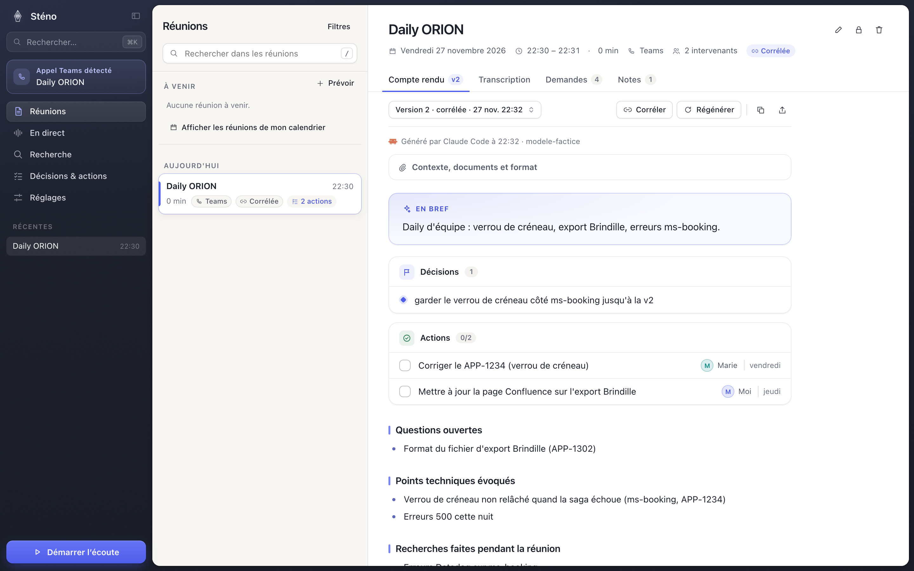

<p align="center"></p>

# Sténo

*English · [Français](README.fr.md)*

**A 100 % local meeting assistant for Mac and Linux (Debian, Ubuntu).** Sténo transcribes
your calls (Teams, Slack, Zoom, Webex, Discord, FaceTime, Google Meet…) and your in-person
meetings, writes the summary, and answers your spoken questions by searching your code, Jira,
Confluence or Datadog. It uses the AI agent you already have (Claude Code, Codex, Gemini CLI,
OpenCode…), with your own subscription. No audio ever leaves your computer, and **Sténo never
publishes anything**: it reads, you publish.



## Features

- **Manual listening**: nothing is recorded without your action. When a call starts in a
  video-conferencing app, Sténo offers to listen; you start from the menu bar, ⌃⌥S (Ctrl+Alt+S
  on Linux) or the window. Stop with one click, the shortcut, or your voice ("*Hey Sténo, stop
  listening*").
- **Live transcription** on your computer, with your voice ("Me", microphone) kept apart from
  the others' (audio of the call app). Pause, mute the mic in Sténo, delete a sentence, filter
  out sentences hallucinated from noise.
- **In-person meetings**: everything goes through the computer's microphone; speakers are told
  apart at the end of the meeting.
- **End-of-meeting re-transcription** with a more accurate model and a fixed language (French
  by default): no more French/English mix from the live pass.
- **Speakers**: identified at the end of the meeting ("Speaker 1, 2…"), and renamable.
- **Voice commands**: "*Hey Sténo, search Datadog errors on ms-booking since yesterday*",
  recognized even mid-sentence, in French or English, or as an aside (hold ⌃⌥Space; on Linux,
  Ctrl+Alt+Space toggles). Short answer as a notification, full sourced answer in the app.
  With Claude Code, the agent can rely on **your skills** (Jira, Datadog, code…), always
  read-only.
- **Summary**: decisions, actions (who / what / when), open questions, technical points, your
  notes. Asides never appear in it.
- **Context and documents**: free text and attached documents (PDF, Excel, CSV, Word,
  Markdown…) to steer the summary; an "⚠️ Important changes" section flags whatever
  contradicts the context. A delay after the meeting leaves time to add them.
- **Meeting preparation**: upcoming meetings (planned in Sténo or read from the calendar:
  macOS Calendar; on Linux, GNOME Calendar / Evolution, Google or Microsoft 365 online
  accounts, or `.ics` files and URLs), invited participants to name the speakers, and
  AI-guided preparation (a few questions, then a written context). Starting to listen at the
  planned time picks up the prepared meeting.
- **Output formats**: standard, daily, client meeting, workshop, decision meeting, summary
  email, Slack/Teams message, and your own formats saved on your computer, written by hand or
  derived from a summary you like. A recurring meeting reuses the format chosen last time.
- **Correlation** (off, on demand or automatic): the summary is cross-checked against your
  repositories and connectors.
- **Exports**: formatted copy for Teams/Slack/email, Markdown, PDF, `.txt` transcript,
  `.srt` / `.vtt` subtitles.
- **History**: full-text search, decisions and actions, natural-language questions, and a
  read-only MCP server (`steno mcp`) for your agents.
- **Sténo in your agent**: a skill and the MCP server installed in one click in Claude Code,
  Codex… ("*rewrite yesterday's summary as a client email*", "*what are my open actions?*").
- UI and summaries in **English or French** (follows the system automatically); light, dark or
  automatic theme.

## Requirements

**macOS**
- macOS 14.2 or later (Apple Silicon recommended).
- Xcode (or the Command Line Tools with Swift 5.10+).

**Linux** (Ubuntu 22.04+, Debian 12+, x86_64 or arm64)
- A desktop with PipeWire (and `pipewire-pulse`, present by default on recent Ubuntu and
  Debian) or PulseAudio.
- The build packages: `make deps` installs them (`sudo apt install …`, list in the Makefile:
  `build-essential`, `meson`, `clang`, `libwebkit2gtk-4.1-dev`, `libpulse-dev`…).
- A recent 4-core processor is enough: transcription runs on the CPU (about ten times faster
  than real time).

**Everywhere**
- Stable Rust (`rustup`) and Node 22 (to build the UI).
- At least one agent CLI installed and signed in: `claude`, `codex`, `gemini`, `opencode`…
- About 2 GB of disk space for the audio models.

## Installation

### macOS

```bash
git clone https://github.com/NakileSolutions/Steno.git steno && cd steno
make install     # builds the audio sidecar, the UI and the app, signs locally,
                 # installs /Applications/Steno.app and the CLI ~/.local/bin/steno,
                 # downloads the audio models
open /Applications/Steno.app
```

The app is built on your Mac, without an Apple developer account: macOS does not block it
since it was not downloaded. It is signed with a local certificate created once in your
keychain ("Steno Local Signing"), so that macOS permissions (microphone, system audio…) are
kept from one update to the next. To install it elsewhere: `make install APP_DIR=~/Applications`.

On first launch, the assistant walks you through: macOS permissions (microphone, system audio,
optional accessibility) or, on Linux, a sound and shortcut check; choosing and testing the
agent; readable repositories; connectors; wake word and voice test. Command-line equivalent:
`steno init`. Diagnostics at any time: `steno doctor`.

### Linux (Debian, Ubuntu)

```bash
git clone https://github.com/NakileSolutions/Steno.git steno && cd steno
make deps        # build packages (once, asks for sudo)
make install     # builds the audio sidecar, the UI and the app, installs into ~/.local
                 # (app, "Sténo" desktop entry, CLI ~/.local/bin/steno),
                 # downloads the audio models (≈ 700 MB)
```

Launch "Sténo" from your applications. Nothing is installed outside your home folder
(`~/.local/lib/steno`, `~/.local/share/applications`, `~/.local/bin`); data goes to
`~/.local/share/Steno` and models to `~/.local/share/Steno/models`. There is no system
permission to grant: the microphone and the audio of video-conferencing apps go through your
session's sound server.

Debian package instead: `make deb` produces `target/release/bundle/deb/steno_<version>_*.deb`
(`sudo apt install ./target/release/bundle/deb/*.deb`); the models are then downloaded on
first launch.

Linux specifics:
- **Video-conferencing apps**: the unofficial Teams client (Teams for Linux), Slack, Zoom,
  Webex, Discord (.deb, Snap or Flatpak packages); Teams and Meet in a browser through the
  "Browser" entry. Sténo captures the audio of the call app only, not other apps.
- **Global shortcuts**: they work under X11. Under Wayland (Ubuntu's default session), create
  them in Settings › Keyboard › Custom Shortcuts with the commands Sténo shows
  (`steno-app --toggle`, `--aside`, `--note`). The tray icon menu and the desktop entry also
  offer these actions.
- **Status bar**: under GNOME, Sténo's icon needs the "AppIndicator" extension (installed by
  default on Ubuntu).
- **Call title**: read from X11 windows (Electron apps often go through XWayland); otherwise
  the meeting takes the calendar title or a dated title.
- **Calendar**: GNOME Calendar / Evolution (online accounts included) is read automatically.
  Other calendars: one `.ics` URL or file per line in `~/.local/share/Steno/calendars.txt`
  (for example a Google calendar's "secret address in iCal format", or a published Outlook
  calendar).
- **Speakers**: echo cancellation (WebRTC) removes the participants' voices from your mic when
  sound plays through speakers; it turns itself off with a headset.

### After installation

**Updates**: Sténo checks GitHub for a new published version and shows it in the sidebar.
"Install" (Settings → Updates) moves your sources to the published version and runs
`make install` again; you then only need to restart. Installation can be automatic (outside
meetings). By hand: `git pull && make install`, or `steno update --install`.

## Usage

| Where | What |
|---|---|
| Menu bar (status bar on Linux) | Start / stop listening, in-person meeting, pause, mute mic, latest answers, open Sténo |
| Window | Meetings (summary, transcript, requests, notes, context), Live, Search, Decisions & actions, Settings |
| Voice | "*Hey Sténo, search / check / take a note / summarize / cancel…*", "*Hey Sténo, stop listening*" (French or English; wake word and verbs are configurable) |
| Shortcuts | ⌃⌥S start/stop · ⌃⌥Space aside (hold) · ⌃⌥N quick note (Linux: Ctrl+Alt+…, or `steno-app --toggle / --aside / --note` bound in the desktop settings) |
| CLI | `steno ask "what did we decide about the export?"` · `steno export <id> [--format txt|srt|vtt]` · `steno doctor` · `steno mcp` · `steno skill install` |

Give your agent read-only access to your meetings: `steno skill install` (or Settings →
Agent → "Sténo in your agent"). The skill is copied to `~/.claude/skills` and
`~/.agents/skills`, and the `steno` MCP server is registered in Claude Code and Codex.

## Privacy

- **Audio never leaves your computer.** Transcription runs locally. Temporary audio files are
  deleted after the summary (configurable retention, 0 days by default).
- **Everything is stored locally**: database `~/Library/Application Support/Steno/steno.db` on
  macOS, `~/.local/share/Steno/steno.db` on Linux (mode 600), daily local backups. No Sténo
  server, no telemetry, no account.
- **Only text is sent, and only to the AI agent you chose**: when you ask, at the end of the
  meeting for the summary, and for correlation if you enable it. It is processed under that
  agent vendor's terms.
- **Confidential meeting**: no AI call at all, and it is left out of questions about past
  meetings and of `steno mcp`. Meetings whose title contains "1:1", "RH", "entretien" or
  "perso" are never correlated (configurable).
- **Asides** (held shortcut) are excluded from the summary, the export, search, `steno mcp` and
  notifications.
- **The agent only reads** and does not receive the environment's API keys that would switch it
  from your subscription to API billing, unless explicitly enabled.
- **Tell participants** the meeting is being transcribed: Sténo offers a message ready to paste
  into the call chat (in the interface language until you edit it). Depending on your country and context, their consent may be required
  (GDPR in Europe).

Details and vulnerability reporting: [`SECURITY.md`](SECURITY.md).

## Architecture

```
audio/StenoAudio/   Swift sidecar: Core Audio capture (process tap of the call app,
                     HAL microphone), Silero VAD, Parakeet v3 and Canary ASR (FluidAudio),
                     diarization → JSON lines
crates/steno-audio-linux/
                     Rust sidecar for Linux, same protocol: PulseAudio / PipeWire capture
                     (call app streams, microphone), WebRTC echo cancellation, Silero VAD,
                     Parakeet v3 and Canary ASR (sherpa-onnx), diarization, EDS calendar
crates/steno-core/  Rust: SQLite (WAL + FTS5), job queue, wake word, echo filter,
                     agent adapters, read-only policy, summary, context
crates/steno-cli/   `steno` CLI: ask, doctor, init, export, mcp, serve, replay, simulate
app/src-tauri/       Tauri 2 app (menu bar, notifications, global shortcuts)
app/ui/              Svelte 5 + Vite UI
agent/               the agent's instructions, playbooks and skill, read-only policy
fixtures/            45-minute synthetic meeting and fake agent CLIs for tests
docs/                component contracts, agent adapters, spikes, handoff
```

## Development

```bash
make test        # Rust (unit, acceptance, perf), Swift (macOS), Vitest, Playwright
make serve       # UI + real core in the browser: http://127.0.0.1:4180/?backend=http
make simulate    # replays the sample meeting through the whole pipeline (fake agent)
make dev         # app with hot reload, simulated sidecar, fake agent
cd app/ui && npm run dev   # the UI alone, with sample data
```

Component interfaces are described in [`docs/contracts.md`](docs/contracts.md), agent CLIs in
[`docs/adapters.md`](docs/adapters.md), the original plan in [`PLAN.md`](PLAN.md), the project
status in [`docs/HANDOFF.md`](docs/HANDOFF.md).

## Contributing

Contributions are welcome: open an issue to discuss before a large change, and run
`make test` before opening a pull request. The `main` branch only accepts pull requests with
green CI and **signed** commits (GPG or SSH). Code, commits, pull requests and technical docs
are in **English** (some older docs and comments are still being migrated from French).

Project rules, including for coding agents (Claude Code, Codex…): [`AGENTS.md`](AGENTS.md).
Releasing a version: [`RELEASING.md`](RELEASING.md).

## Contributors

<a href="https://github.com/NakileSolutions/Steno/graphs/contributors">
  
</a>

## License

[MIT](LICENSE) © 2026 Nakile Solutions. Audio models and third-party libraries have their own
licenses: see [`NOTICE.md`](NOTICE.md).

---

<sub>Built by Nakile Solutions.</sub>
